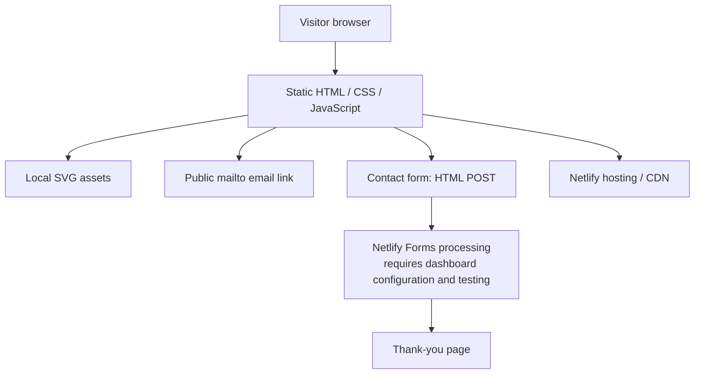
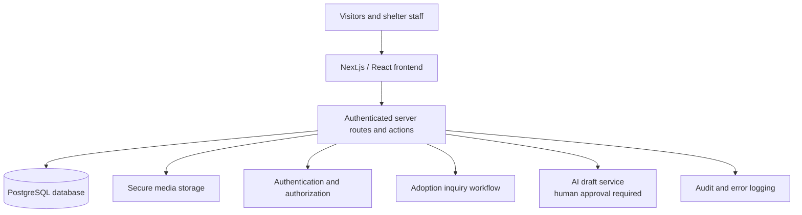

# PawBridge — Technical Architecture

## 1. Current implementation (deployed prototype)

The repository currently hosts a static, English-language website, not a full-stack adoption management system.

### Files

- `index.html` — public landing page and Netlify Forms integration.
- `mission.html`, `services.html`, `project.html`, `faq.html`, `privacy.html` — standalone content pages.
- `404.html` and `thanks.html` — custom error and contact confirmation pages.
- `assets/css/tokens.css` — canonical color, radius and shadow tokens.
- `assets/css/site.css` — base site styles and layout.
- `assets/css/pages.css` — shared secondary-page components.
- `assets/css/theme.css` — botanical identity and 2.1 component refinements.
- `assets/js/site.js` — mobile navigation and portfolio filters.
- `assets/js/contact.js` — Netlify form progressive enhancement; unchanged in 2.1.
- `assets/` — favicon and original SVG illustrations.

### Current limitations

- No application server or database.
- No animal directory, verified profiles, user accounts, shelter dashboard, or adoption workflow.
- Netlify form capture was confirmed with a real submission in the owner's dashboard; email notification delivery requires separate verification.
- Unit-level static structure checks exist, but full browser accessibility, integration, performance and security audits are still future work.

## 2. Proposed architecture (future roadmap)

Potential technologies: Next.js + TypeScript, PostgreSQL / Supabase, protected storage, server-side AI API integration, GitHub Actions, and automated tests. **None of these future components are claimed to be live today.**

## 3. Initial data model (proposal)

- `shelters`: id, name, region, verified_status, contact_details
- `users`: id, shelter_id, role, authentication_reference
- `animals`: id, shelter_id, name, species, status, description, profile_images
- `inquiries`: id, animal_id, contact_information, consent_record, status
- `campaign_drafts`: id, shelter_id, draft_text, human_review_state

Sensitive inquiry information should be collected minimally, access-controlled, and retained only for a defined purpose. Avoid placing private contact details or API keys in public GitHub files.

## 4. Engineering principles

1. Human verification of adoption listings and generated stories.
2. Separation of public content from private inquiries.
3. Role-based access for authorized shelters.
4. Accessibility and mobile responsiveness.
5. Automated testing and transparent deployment checks.

## 5. Suggested first Devin task

**Migrate the existing static site into a Next.js + TypeScript project without changing its public design or content.** Set up a reproducible local development command, lint checks, and Playwright smoke tests for navigation and contact form UI. Do not introduce a live database or claim deployment readiness until explicitly tested.
